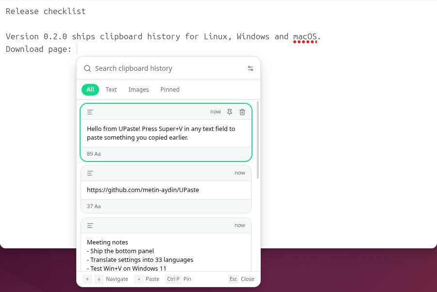
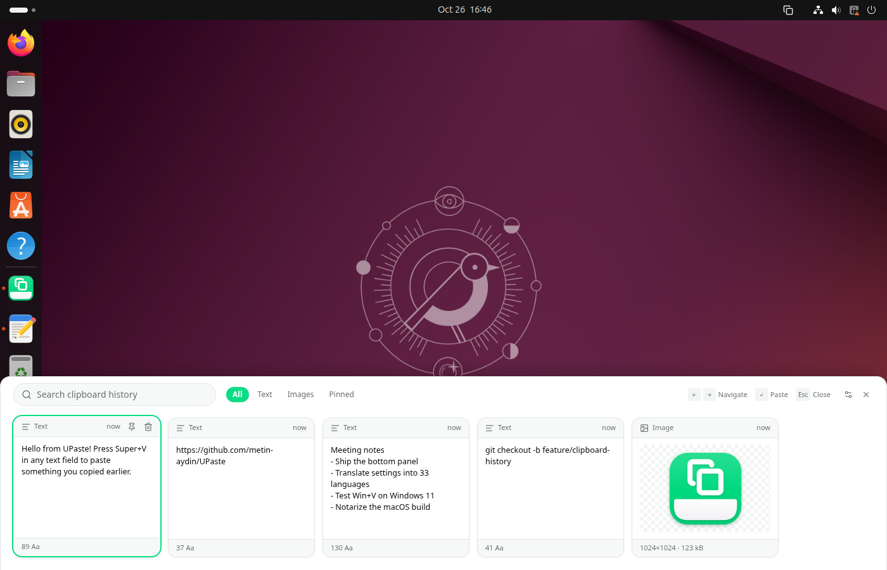
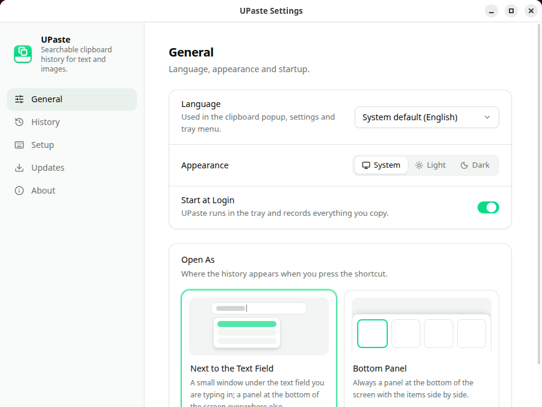

# UPaste

**Searchable clipboard history for Linux, Windows and macOS.** Press one shortcut in any text field and pick
something you copied earlier: text or images, right under your text cursor, just like Win+V on Windows.

[](https://github.com/metin-aydin/UPaste/actions/workflows/ci.yml)
[](https://github.com/metin-aydin/UPaste/releases/latest)
[](LICENSE)



## Features

- **Opens where you type.** The history appears right under the text cursor and follows the text field if its window
  moves. The app you are typing in keeps its focus and its blinking cursor.
- **Bottom panel when there is no text cursor.** On the desktop, in an image editor or in apps that do not report their
  cursor, the history opens as a panel along the bottom of the screen with the items side by side. You can also choose
  to always open the panel.
- **Text and images.** Everything you copy is kept, including copies made by apps and scripts, not only Ctrl+C.
- **Search.** Type to filter; matches are highlighted. Search ignores case and accents (Turkish İ/ı included).
- **Pin** the items you use often. Pinned items are never deleted.
- **Keyboard first.** Arrow keys to move, Enter to paste, Esc to close; or click a card.
- **Multi-monitor aware.** The history opens on the screen you are working on.
- **Your choice of shortcut**, history retention (1 day to forever) and one-click clearing.
- **33 languages**, light and dark theme, tray icon, start at login and automatic updates.



## Download

Get the latest version from the [Releases page](https://github.com/metin-aydin/UPaste/releases/latest).

| System                                  | File                                                        | Default shortcut                     |
| --------------------------------------- | ----------------------------------------------------------- | ------------------------------------ |
| Ubuntu, Debian and other GNOME desktops | `upaste_<version>_amd64.deb` or `UPaste-<version>.AppImage` | <kbd>Super</kbd>+<kbd>V</kbd>        |
| Windows 10 and 11                       | `UPaste-<version>-Setup.exe`                                | <kbd>Win</kbd>+<kbd>V</kbd>          |
| macOS (Apple Silicon)                   | `UPaste-<version>-mac-arm64.dmg`                            | <kbd>⌘</kbd><kbd>⇧</kbd><kbd>V</kbd> |
| macOS (Intel)                           | `UPaste-<version>-mac-x64.dmg`                              | <kbd>⌘</kbd><kbd>⇧</kbd><kbd>V</kbd> |

UPaste updates itself: it checks GitHub Releases shortly after startup and every few hours, and installs a new version
only when you ask.

## First run

**Linux (GNOME on Wayland or X11).** UPaste needs its small GNOME Shell extension to find your text cursor, catch the
shortcut and paste into other apps. The **Setup** page installs it with one click; log out and back in once to load
it. Later extension updates load without logging out. If another app already uses Super+V (for example GNOME's
notification list or another clipboard manager), Setup offers to take the shortcut over and can give it back.

**Windows.** Win+V opens UPaste instead of the built-in Windows clipboard history. Choose a different shortcut in
Setup to give Win+V back to Windows. The installer is not code-signed yet, so SmartScreen may warn you: choose
_More info_ → _Run anyway_.

**macOS.** UPaste lives in the menu bar. Allow it under _System Settings → Privacy & Security → Accessibility_ (the
Setup page opens the right place) so it can find your text cursor and paste the item you pick. Without this permission
the history still opens, and the chosen item is copied so you can paste it with ⌘V. The app is signed and notarized
by Apple.



## Privacy

Your clipboard history never leaves your computer. It is stored in your user data folder and old items are deleted
after the retention period you choose. Items that password managers mark as secret are not recorded.

## Build from source

Requirements: Node.js 22 and npm.

```bash
npm ci
npm run dev        # run in development
npm run build      # type check and build
npx electron-builder --linux   # or --win, --mac
```

Other useful commands: `npm run lint`, `npm run test:unit`, `node dev/i18n-check.mjs`.

UPaste is built with Electron, React, Tailwind CSS and shadcn/ui. The Linux integration is a GNOME Shell extension in
`resources/gnome-extension`; Windows and macOS use their native APIs through [koffi](https://koffi.dev).

## License

[MIT](LICENSE)
